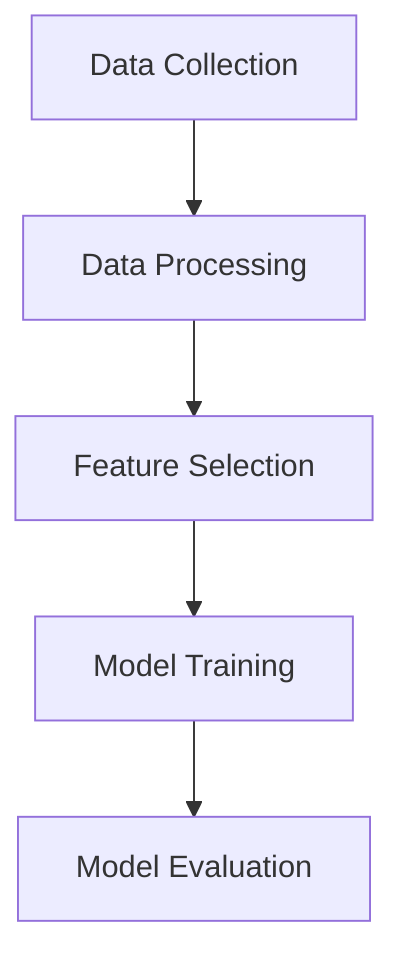

# Image Classification DVC

**Author**: Tanniru Hari Sri Shanmukha Sai  
**PRN**: 23070126135

## Project Overview

This repository implements a modular image classification system using Python, TensorFlow/Keras, OpenCV, NumPy, Pandas, Matplotlib, scikit-learn, and DVC. The application follows a clean stage-based architecture and uses MobileNetV2 transfer learning to classify images from the Intel Image Dataset.

The machine learning workflow is fully automated with DVC and is organized into five reproducible stages:

1. Data collection
2. Data processing
3. Feature extraction
4. Model training
5. Model evaluation

## Repository Structure

```text
Image-Classification-DVC/
├── artifacts/
│   ├── features/
│   ├── model/
│   ├── metrics/
│   └── processed/
├── data/
│   ├── processed/
│   └── raw/
├── src/
│   ├── data_collection.py
│   ├── data_processing.py
│   ├── feature_selection.py
│   ├── model_evaluation.py
│   ├── model_training.py
│   ├── config.py
│   └── utils.py
├── dvc.yaml
├── dvc.lock
├── main.py
├── params.yaml
├── requirements.txt
├── README.md
└── .gitignore
```

## Environment Setup

The project targets Python 3.11.

Create a virtual environment and install dependencies:

```bash
python3.11 -m venv .venv
source .venv/bin/activate
python -m pip install --upgrade pip
pip install -r requirements.txt
```

If you need to rerun the pipeline on this macOS machine, DVC should use the local site cache path that was validated during execution:

```bash
DVC_SITE_CACHE_DIR="$PWD/.dvc/site-cache" dvc repro
```

## Configuration

All tunable parameters are stored in [params.yaml](params.yaml). This includes dataset location, image size, batch size, learning rate, optimizer, dropout rate, dense units, validation and test splits, augmentation settings, seed, loss function, and model metadata.

## DVC Pipeline

The pipeline is fully automated through [dvc.yaml](dvc.yaml). The stages are executed in order and produce versioned outputs and metrics.



## Running the Project

Execute the full machine learning pipeline with:

```bash
source .venv/bin/activate
DVC_SITE_CACHE_DIR="$PWD/.dvc/site-cache" dvc repro
```

For manual stage-level execution during development, the following module entrypoints are available:

```bash
python -m src.data_collection
python -m src.data_processing
python -m src.feature_selection
python -m src.model_training
python -m src.model_evaluation
```

## Expected Outputs

After a successful run, the following artifacts are generated:

- `data/raw/` for the downloaded or loaded dataset
- `data/processed/` for the train, validation, and test splits
- `artifacts/features/` for the MobileNetV2 feature extractor
- `artifacts/model/` for the trained classification model and history files
- `artifacts/metrics/metrics.json` for accuracy, precision, recall, and F1 score
- `artifacts/metrics/confusion_matrix.png` for the confusion matrix

## Submission Checklist

Before zipping the project for submission, keep the source and pipeline files, and exclude local runtime noise such as the virtual environment and DVC site cache.

Recommended files to include:

- `src/`
- `data/`
- `artifacts/`
- `params.yaml`
- `dvc.yaml`
- `dvc.lock`
- `requirements.txt`
- `README.md`
- `main.py`
- `.gitignore`

Recommended folders to exclude from the zip:

- `.venv/`
- `.dvc/site-cache/`
- `__pycache__/`

## Dataset Note

The project is configured for Kaggle-based dataset retrieval. If Kaggle authentication is unavailable, place the dataset manually in `data/raw/` before running the pipeline.
